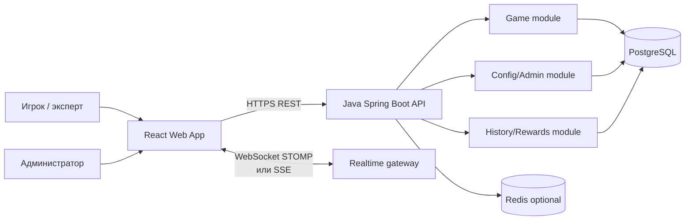

# «Воздушный шар» — архитектура проекта

Документ подготовлен по материалам:

- `Постановка_задачи_Чемпионат_России_2026_Продуктовое_программирование.pdf` (18 страниц);
- `Критерии_оценки_Воздушный_шар_Чемпионат_России_2026_Продуктовое.pdf` (6 страниц).

Целевая реализация: backend на Java, frontend на React. Для MVP выбран модульный монолит: одна Java-служба с чёткими внутренними границами модулей проще для локального запуска и демонстрации, при этом границы домена позволяют позднее вынести рейтинг, турниры или интеграции в отдельные сервисы.

## 1. Обязательный объём MVP

Система должна позволять эксперту без обращения к команде пройти пять обязательных сценариев:

1. Выбрать красную тему (12 уровней) или зелёную (9 уровней), выбрать один из четырёх вариантов ставки/бустера, увидеть баланс, историю и правила, затем запустить раунд. Ставка списывается атомарно; вариант, превышающий баланс, недоступен.
2. Во время полёта видеть рост коэффициента и выполнить `cashout` после первого уровня. Выигрыш фиксируется как `ставка × зафиксированный коэффициент`, после завершения раунда сервер раскрывает уровень, на котором шар лопнул бы.
3. Не выполнять `cashout` и получить проигрыш ставки при взрыве шара.
4. Достичь уровня с бустером до `cashout`: начисляются дополнительные очки, событие показывается в интерфейсе.
5. Изменить очки за уровень через конфигурацию или админ-интерфейс без правки исходников; изменение применяется к новым раундам.

Дополнительные модули (живой рейтинг, турнирная таблица, upsell, отдельный стартовый экран, полноценное серверное восстановление игры) проектируются как расширения и не блокируют MVP.

Нефункциональные ограничения из задания: Java для основных backend-механик, серверная генерация случайных событий, realtime или polling не реже одного раза в секунду, работа в Chrome/Safari/Firefox, адаптивность 320–1920 px, независимый локальный запуск по README, демонстрационный пользователь с ненулевым балансом.

## 2. Контекст и границы системы



Внешние платежные и лотерейные системы в MVP отсутствуют. Для будущей интеграции предусмотрены порты `PaymentGateway`, `LotteryGateway` и `TournamentProvider`; текущая реализация может быть in-memory/mock.

## 3. Репозиторий и технологический стек

```text
/
  backend/
    src/main/java/com/example/balloon/
      api/             # REST, WebSocket, DTO, обработка ошибок
      application/     # use cases, транзакционные сервисы
      domain/          # агрегаты, value objects, state machine, порты
      infrastructure/  # JPA, PostgreSQL, Redis, security, config
    src/main/resources/
      application.yml
      game-config.yml
      db/migration/     # Flyway
    build.gradle       # Java 21, Spring Boot 3.x
    Dockerfile
  frontend/
    src/
      app/              # routing, providers, auth
      features/game/    # выбор ставки, полёт, cashout, результат
      features/history/
      features/admin/
      shared/api/       # typed API client
      shared/ui/        # доступные адаптивные компоненты
    package.json        # React + TypeScript + Vite
    Dockerfile
  infra/
    docker-compose.yml  # app, postgres, optional redis
  docs/
    ARCHITECTURE.md
    api/openapi.yaml
  README.md
```

Рекомендуемый стек:

- Java 21, Spring Boot 3, Spring Web, Spring WebSocket, Spring Security, Bean Validation;
- PostgreSQL 16, Spring Data JPA, Flyway, Testcontainers;
- Redis опционально: pub/sub для нескольких экземпляров и краткоживущие realtime-сессии;
- React 18/19, TypeScript, Vite, React Router, TanStack Query, Zustand; CSS Modules или Tailwind без тяжёлой графической зависимости;
- Docker Compose для воспроизводимого запуска; OpenAPI/Swagger UI для проверки API.

Все компоненты, выбранные для прототипа, имеют открытые лицензии и запускаются локально без платных сервисов: OpenJDK, Spring Boot, PostgreSQL, Redis, React, Vite, Docker Compose и Playwright.

## 4. Backend-модули

### `game`

Содержит агрегат `Round` и авторитетную state machine:

`CREATED -> STARTED -> (CASHED_OUT) -> CRASHED -> SETTLED`.

`cashout` разрешён только после первого уровня и пока раунд не перешёл в `CRASHED`. Повторный запрос с тем же `Idempotency-Key` возвращает тот же результат. Переходы и начисления выполняются в одной транзакции с блокировкой строки раунда и кошелька.

До старта раунда сервер фиксирует snapshot конфигурации, seed/nonce, crash point и позицию бустера. Клиент не присылает коэффициент, уровень, очки или результат. Сервер публикует commitment `SHA-256(seed + roundId + configVersion)`; seed и параметры раскрываются после завершения, чтобы можно было проверить неизменность исхода.

Клиентская анимация только отображает серверное состояние. Сервер отправляет события `ROUND_STARTED`, `LEVEL_REACHED`, `BOOSTER_ACTIVATED`, `MULTIPLIER_TICK`, `CASHOUT_ACCEPTED`, `CRASHED`, `ROUND_SETTLED`. Для MVP достаточно WebSocket; fallback — REST polling с интервалом 500–1000 мс.

### `wallet`

Баланс бонусных баллов и журнал проводок (`BET_DEBIT`, `CASHOUT_CREDIT`, `REWARD_CREDIT`, `ADMIN_ADJUSTMENT`). Денежные значения не используются: баллы хранятся как целые `BIGINT`. Списание ставки проверяет баланс и создаёт проводку с уникальным `round_id`.

### `economy/config`

Версионированная конфигурация игры. Минимальный набор:

- `gameId`, `gameName`, `active`;
- тема и число уровней (green=9, red=12);
- параметры модели риска (`baseHazard`, `hazardGrowth`, `maxHazard`, `rtp`);
- вероятности позиции бустера по уровням;
- множители бустеров `x1..x4`;
- `pointsPerLevel`, `pointsCashoutBonus`, `pointsBoosterBonus`;
- `minWinAmount`, `popupTimeout`.

Источник MVP — `game-config.yml` с периодическим/ручным reload. Расширение — защищённые REST-операции админки с валидацией диапазонов и созданием новой версии. Уже начатые раунды используют свой snapshot; новая конфигурация применяется с нового раунда.

### `history/rewards`

После `CRASHED` рассчитывает очки, награду и итог, создаёт запись истории и публикует `ROUND_SETTLED`. Награда — отдельная сущность (например, фрагмент коллекции), не смешанная с бонусным балансом.

### `identity/admin`

Для прототипа — JWT access token и роли `PLAYER`, `ADMIN`; seed-данные создают демонстрационного пользователя с ненулевым балансом. Админские методы закрыты ролью `ADMIN`.

## 5. Модель данных

Основные таблицы PostgreSQL:

| Таблица | Ключевые поля | Назначение |
|---|---|---|
| `users` | `id`, `username`, `role`, `created_at` | Игроки и администраторы |
| `wallets` | `user_id`, `balance`, `version` | Текущий бонусный баланс; optimistic lock |
| `wallet_transactions` | `id`, `user_id`, `round_id`, `type`, `amount`, `balance_after` | Аудит всех списаний/начислений |
| `game_configs` | `id`, `version`, `payload_json`, `active_from`, `created_by` | Версии настроек |
| `rounds` | `id`, `user_id`, `theme`, `bet_amount`, `booster_multiplier`, `state`, `crash_multiplier`, `booster_level`, `cashed_out_multiplier`, `commitment`, `config_version`, timestamps | Авторитетное состояние раунда и его snapshot |
| `round_events` | `id`, `round_id`, `sequence`, `type`, `payload_json`, `occurred_at` | Воспроизводимый журнал realtime-событий |
| `score_ledger` | `id`, `user_id`, `round_id`, `reason`, `points` | Очки за уровни, cashout и бустер |
| `rewards` | `id`, `code`, `name`, `metadata_json` | Каталог игровых наград |
| `user_rewards` | `user_id`, `reward_id`, `round_id`, `quantity` | Награды игрока |
| `tournaments` / `tournament_scores` | ... | Опциональный рейтинг и турнир |

Ограничения целостности: `round_events(round_id, sequence)` unique, один debit на раунд, один cashout на раунд, `cashout_multiplier <= crash_multiplier`, переходы state machine проверяются доменом, все timestamps — UTC.

## 6. API и realtime-контракт

Базовый префикс: `/api/v1`. Все ответы содержат `requestId`; ошибки — RFC 7807 Problem Details.

| Метод | Endpoint | Назначение |
|---|---|---|
| `GET` | `/me` | Профиль и баланс |
| `GET` | `/game/config?theme=RED\|GREEN` | Ставки, бустеры, уровни, публичные правила |
| `GET` | `/rounds/history?limit=50` | Общая история завершённых раундов прототипа |
| `POST` | `/rounds` | Старт раунда: `{theme, betOptionId, idempotencyKey}` |
| `GET` | `/rounds/{id}` | Текущее авторитетное состояние |
| `POST` | `/rounds/{id}/cashout` | Запрос cashout; коэффициент берётся сервером |
| `GET` | `/rounds/{id}/proof` | Commitment, раскрытый seed и параметры после settlement |
| `GET` | `/rules` | Правила, синхронизированные с моделью |
| `GET` | `/admin/config` | Текущая версия конфигурации (`ADMIN`) |
| `PUT` | `/admin/config` | Валидация и публикация новой версии (`ADMIN`) |

WebSocket endpoint: `/ws`, подписка `/topic/round/{roundId}`. Сообщение содержит `roundId`, `sequence`, `type`, `serverTime`, `level`, `multiplier`, `pointsDelta` и, когда допустимо, `boosterActivated`. Клиент отбрасывает сообщения с уже обработанным `sequence` и при разрыве восстанавливается через `GET /rounds/{id}`.

Пример старта:

```http
POST /api/v1/rounds
Authorization: Bearer <token>
Idempotency-Key: 01J...
Content-Type: application/json

{"theme":"RED","betOptionId":"red-x2"}
```

```json
{
  "roundId": "9d...",
  "state": "STARTED",
  "betAmount": 20,
  "boosterMultiplier": 2,
  "levels": 12,
  "commitment": "sha256:...",
  "serverTime": "2026-09-11T10:00:00Z"
}
```

## 7. Математическая модель и честность

Конкретные параметры должны быть вынесены в конфигурацию и описаны в README. Рекомендуемая MVP-модель:

1. CSPRNG генерирует секретный `seed`; для каждого уровня из `HMAC-SHA256(seed, roundId:level)` получается равномерное `u(level)`.
2. `hazard(level) = min(maxHazard, baseHazard × hazardGrowth^(level-1))` — шанс взрыва растёт экспоненциально вместе с давлением в шаре. Шар лопается на первом уровне, где `u(level) < hazard(level)`.
3. `multiplier(level) = rtp / Π(1 - hazard(i))` — коэффициент обратен вероятности долететь, поэтому растёт экспоненциально, а возврат игроку одинаков на любом уровне.
4. Позиция бустера выбирается сервером из snapshot конфигурации; бустер умножает бонусные очки и не влияет на выплату, чтобы не ломать RTP.
5. Коэффициент на клиенте не вычисляется. Сервер ведёт уровень по своему таймеру и отдаёт лестницу коэффициентов вместе с состоянием раунда.
6. `cashout` атомарно фиксирует текущий серверный коэффициент. Если шар долетел до последнего уровня, выплата начисляется автоматически.
7. При взрыве без cashout выплата равна нулю; очки рассчитываются по фактически пройденным уровням.

Для демонстрации используется dev-режим с фиксированным seed только в локальном профиле; production/demo profile использует CSPRNG. Клиент не может передать crash point, booster level, multiplier или points.

## 8. React frontend

Маршруты: `/play` (выбор темы/ставки), `/round/:id` (полёт), `/round/:id/result`, `/history`, `/rules`, `/admin`.

Состояние разделяется на server state (TanStack Query) и transient UI state (Zustand). Компоненты:

- `ThemeSwitcher`, `BetOptionCard`, `Balance`, `HistoryDrawer`, `RulesModal`;
- `FlightCanvas` или CSS-анимация, которая получает только server events;
- `MultiplierDisplay`, `LevelTrack`, `BoosterEffect`, `CashoutButton`;
- `ResultPanel`, `RewardCard`, `PlayAgainButton`;
- опционально `LiveLeaderboard`, `TournamentSheet`, `UpsellModal`, `AdminConfigForm`.

Доступность: клавиатурная навигация, видимый focus, контраст, aria-live для cashout/crash, понятное состояние disabled при недостаточном балансе. Breakpoints проверяются на 320, 375, 768, 1024 и 1920 px. Анимация выполняется через CSS transform/requestAnimationFrame, без блокирующих вычислений и тяжёлого WebGL.

При обрыве WebSocket клиент показывает последнее подтверждённое состояние, делает polling и предлагает возобновить экран; для MVP незавершённый раунд также можно кэшировать в `localStorage` не более часа.

## 9. Безопасность, надёжность и наблюдаемость

- TLS в окружении публикации, CORS только для frontend origin, JWT с коротким TTL, refresh token в HttpOnly cookie.
- Валидация DTO, rate limit на `cashout` и старт раунда, CSRF-защита для cookie-маршрутов, отсутствие секретов в репозитории.
- Транзакции PostgreSQL и блокировки кошелька/раунда исключают двойное списание и двойной cashout.
- Структурированные JSON-логи с `requestId`, `roundId`, `userId`; audit log для изменения конфигурации.
- `/actuator/health`, `/actuator/metrics`, журнал событий раунда и Swagger UI позволяют независимо проверить backend.

## 10. Локальный запуск и проверяемость

`docker compose up --build` поднимает PostgreSQL, backend и frontend. При старте Flyway создаёт схему и seed-данные: `demo/demo` с балансом, достаточным для всех сценариев. README должен содержать URL, учётные данные, команды запуска, пример API, описание модели и способ изменить `pointsPerLevel`.

Минимальный набор проверок:

- unit-тесты `CrashModel`, `BoosterPolicy`, `RoundStateMachine`, `SettlementService`;
- интеграционные тесты PostgreSQL/Testcontainers на start/cashout/crash/idempotency/config version;
- contract/e2e тест обязательных сценариев через Playwright;
- проверка OpenAPI и ручной curl-сценарий для независимой оценки начислений.

## 11. Трассировка требований к компонентам

| Требование PDF | Реализация |
|---|---|
| Backend Java и серверная случайность | `game` domain/application, `CrashModel`, CSPRNG/HMAC |
| 9 зелёных и 12 красных уровней | `game_configs`, `ThemeConfig`, `LevelTrack` |
| Ставки, баланс, запрет при нехватке | `wallet`, `wallet_transactions`, `POST /rounds` |
| Cashout до crash и неизменный выигрыш | транзакционный `CashoutService`, state machine |
| Crash без cashout | `CrashScheduler`, `SettlementService` |
| Бустер на уровне | `BoosterPolicy`, `BOOSTER_ACTIVATED` |
| История и правила | `rounds`, `round_events`, `/history`, `/rules` |
| Награда и отдельные игровые очки | `score_ledger`, `rewards`, `user_rewards` |
| Конфигурация без релиза | YAML hot reload или `/admin/config`, version snapshot |
| Realtime ≤1 сек | WebSocket STOMP, REST polling fallback 500–1000 мс |
| Адаптивность и доступность | React responsive layout, CSS animation, aria/focus |
| Проверяемость и воспроизводимость | OpenAPI, Actuator, audit/events, Docker Compose, seed user |

## 12. План реализации

1. Создать Gradle Spring Boot backend, миграции и seed-пользователя.
2. Реализовать domain-модель раунда, кошелёк, конфигурацию и unit-тесты.
3. Добавить REST start/cashout/history/rules, затем WebSocket events и proof.
4. Собрать React-сценарии выбора, полёта, результата и истории; подключить адаптивность.
5. Добавить YAML reload и минимальную админ-форму.
6. Покрыть обязательные сценарии Playwright, собрать Docker Compose и README с демонстрацией.
7. После стабильного MVP — рейтинг, турниры, upsell и серверное восстановление на 30 дней.
